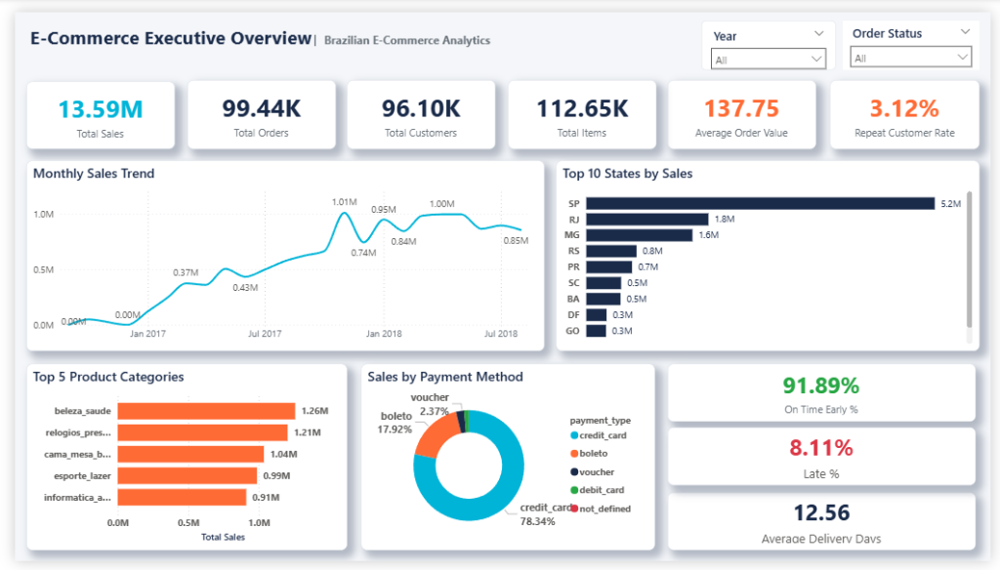
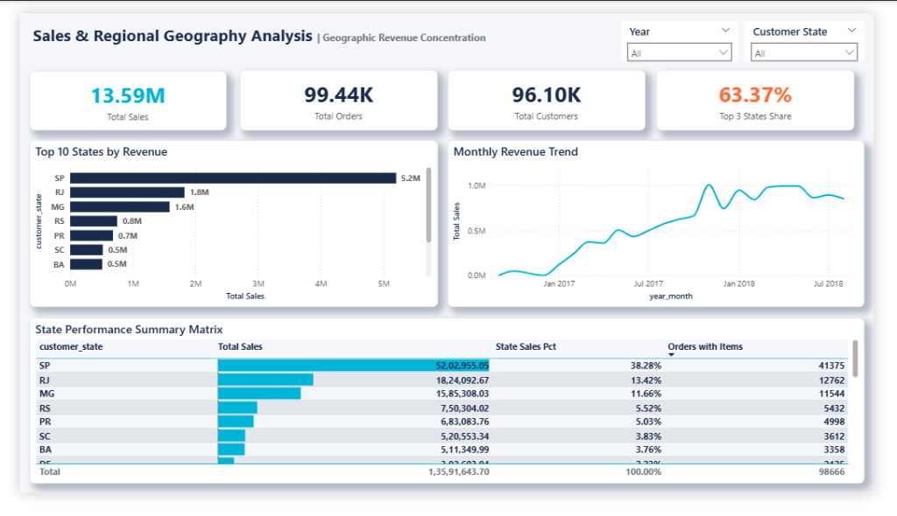
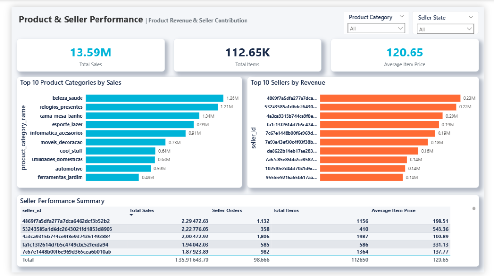
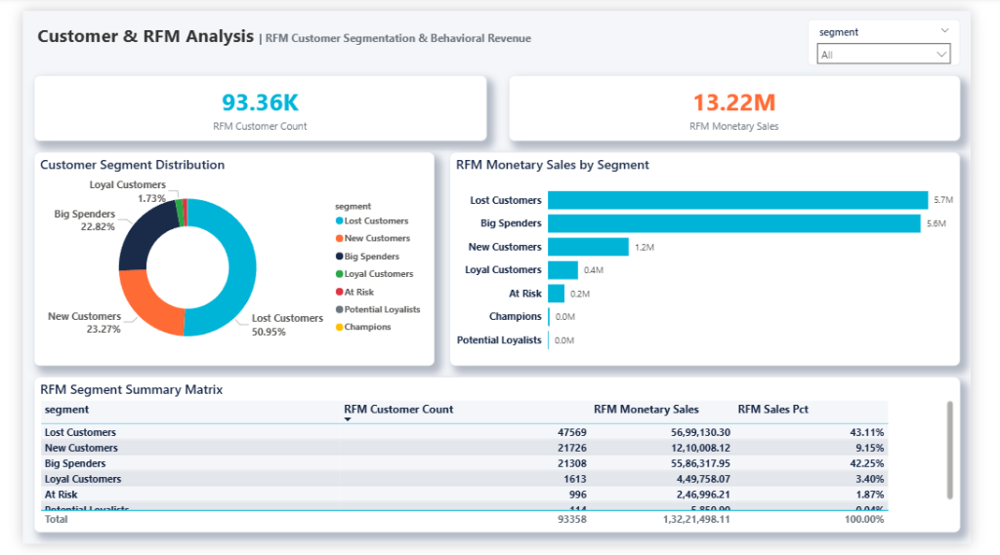
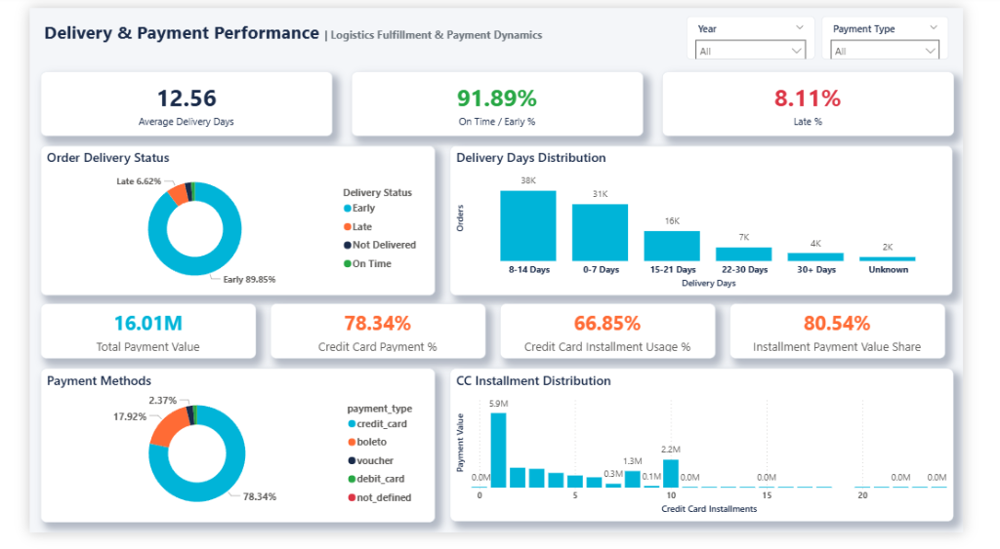
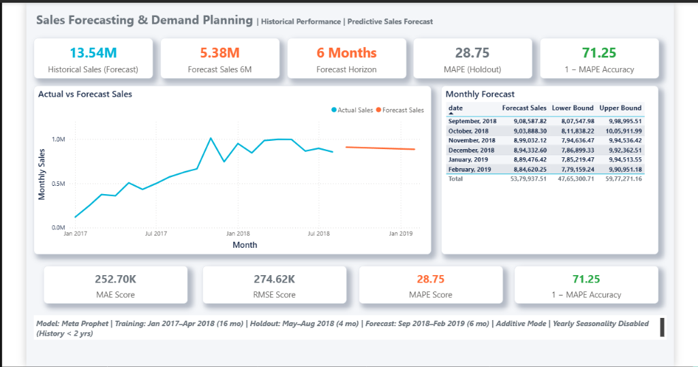

# Retail Sales Intelligence Platform

A production-grade Business Intelligence and Predictive Analytics solution built on the Brazilian E-Commerce public dataset (Olist). The platform integrates a relational data warehouse (MySQL), an analytical dimensional star schema, advanced DAX modeling, RFM customer segmentation, and Meta Prophet time-series sales forecasting inside a 6-page interactive Power BI suite.

---

## 📊 Executive Summary & Key Metrics

All metrics across the analytics pipeline have been verified against raw transaction records:

| Metric Category | Metric Name | Verified Value |
|---|---|---:|
| **Scale & Volume** | Total Order-Item Records | **112,650** |
| | Overall Orders | **99,441** |
| | Unique Customers | **96,096** (~96.10K) |
| | Marketplace Sellers | **3,095** |
| **Financial & Unit Economics** | Total Revenue (Sales) | **₹13.59M** (₹13,591,643.70) |
| | Average Order Value (AOV) | **₹137.75** |
| | Average Item Price | **₹120.65** |
| | Repeat Customer Rate | **3.12%** (2,997 buyers) |
| **Geographic Concentration** | Top 3 States Revenue Share | **63.37%** (SP, RJ, MG) |
| **Customer Segmentation** | RFM Active Customer Base | **93,358** |
| | RFM Monetary Sales | **₹13.22M** |
| **Logistics & SLAs** | On-Time / Early Delivery Rate | **91.89%** |
| | Late Delivery Rate | **8.11%** |
| | Average Delivery Lead Time | **12.56 Days** |
| **Payment Dynamics** | Credit Card Payment Share | **78.34%** (₹12.54M) |
| | Installment Payment Value Share | **80.54%** |
| **Predictive Analytics** | 6-Month Sales Forecast | **₹5.38M** (₹5,379,937.51) |
| | Holdout Forecast Accuracy (1 − MAPE) | **71.25%** |
| | Out-of-Sample MAPE | **28.75%** |
| | Out-of-Sample MAE | **₹252.70K** (₹252,696.96) |
| | Out-of-Sample RMSE | **₹274.62K** (₹274,622.76) |

---

## 🏗️ Architecture & Data Pipeline

```
┌─────────────────────────┐
│   Raw Olist Datasets    │ (Orders, Items, Customers, Products, Sellers, Payments)
└────────────┬────────────┘
             │
             ▼
┌─────────────────────────┐
│   Python / Pandas ETL   │ (Data validation, anomaly exclusion, date dimension generation)
└────────────┬────────────┘
             │
             ▼
┌─────────────────────────┐
│  MySQL Data Warehouse   │ (Star schema DDL, indexing, relational constraints)
└────────────┬────────────┘
             │
             ▼
┌─────────────────────────┐     ┌─────────────────────────┐
│   Power BI Star Schema  │◄────┤  Meta Prophet Forecast  │ (6-Month demand planning)
│  (6 Interactive Pages)  │     └─────────────────────────┘
└─────────────────────────┘
```

---

## 📑 Power BI Dashboard Overview (6 Pages)

The interactive dashboard is structured into 6 focused analytical perspectives:

### 1. Executive Overview
*High-level business health monitoring macro sales run-rate, customer counts, average order value, repeat purchase rates, and primary logistics SLAs.*


---

### 2. Sales & Regional Geography Analysis
*Geographic revenue concentration matrix and state-level market shares identifying SP, RJ, and MG as driving 63.37% of total sales.*


---

### 3. Product & Seller Performance
*Category revenue leadership (Beleza & Saúde #1) and seller partner distribution using row-context safe DAX measures.*


---

### 4. Customer & RFM Analysis
*Behavioral segmentation categorizing 93.36K unique customers into 7 strategic tiers (Lost, Big Spenders, New, Loyal, At Risk, Potential Loyalists, Champions).*


---

### 5. Delivery & Payment Performance
*Logistics SLA fulfillment (91.89% on-time rate / 12.56-day avg fulfillment) contrasted with credit card installment adoption dynamics.*


---

### 6. Sales Forecasting & Demand Planning
*Predictive time-series model projecting ₹5.38M across a 6-month forward horizon with 80% confidence bounds, evaluated via 4-month holdout backtesting.*


---

## 📈 Predictive Forecasting Methodology

* **Model Engine:** Meta / Facebook Prophet (`seasonality_mode='additive'`, `changepoint_prior_scale=0.3`).
* **Seasonality Selection:** `yearly_seasonality=False` due to having 20 months of clean historical data (fewer than 2 full seasonal cycles).
* **Validation Strategy:** 4-month chronological holdout backtest (Training: Jan 2017 – Apr 2018; Test Holdout: May 2018 – Aug 2018) avoiding random split data leakage.
* **Evaluation Metrics:** Out-of-sample **MAPE = 28.75%**, corresponding to a **71.25% 1 − MAPE Accuracy Score** with **MAE = ₹252.70K**.

---

## 🛠️ Tech Stack & Skills

* **Business Intelligence:** Power BI Desktop, DAX, Power Query, Data Modeling, Star Schema Design.
* **Database & SQL:** MySQL 8.0, DDL Schema Design, Window Functions, CTEs, Aggregations, Query Optimization.
* **Programming & Modeling:** Python 3.10+, Pandas, NumPy, Meta Prophet, Scikit-Learn, Jupyter.
* **Analytics Techniques:** RFM Behavioral Segmentation, Time-Series Forecasting, Holdout Backtesting, Logistics SLA Tracking.

---

## 📁 Repository Structure

```
Retail-Sales-Intelligence-Platform/
├── README.md
├── requirements.txt
├── .gitignore
├── .gitattributes
│
├── data/
│   ├── README.md                  # Ingestion instructions and data dictionary
│   └── sample/                    # Sample records for each dimensional table
│       ├── dim_customer_sample.csv
│       ├── dim_date_sample.csv
│       ├── dim_product_sample.csv
│       ├── dim_seller_sample.csv
│       ├── fact_order_items_sample.csv
│       ├── fact_payments_sample.csv
│       ├── customer_rfm_sample.csv
│       ├── forecast_sales.csv
│       └── forecast_metrics.csv
│
├── sql/
│   ├── README.md
│   ├── 01_schema_ddl.sql          # MySQL database & star schema table creation
│   └── 02_analytical_queries.sql  # Benchmark analytical queries
│
├── python/
│   ├── README.md
│   ├── data_preparation/
│   │   └── build_star_schema.py   # ETL pipeline from raw CSVs to dimensional tables
│   ├── rfm_analysis/
│   │   └── rfm_segmentation.py    # R/F/M quintile calculation and segment mapping
│   └── forecasting/
│       └── prophet_forecast.py    # Prophet model training, validation, and export
│
├── notebooks/
│   └── exploratory_data_analysis.ipynb
│
├── powerbi/
│   ├── README.md
│   ├── Retail_Sales_Intelligence_Platform.pbix # Final 6-Page master Power BI report
│   └── AnalyticsPro_Theme.json    # Corporate styling theme
│
├── screenshots/                   # High-resolution dashboard page screenshots
│   ├── executive_overview.png
│   ├── sales_geography.png
│   ├── product_seller.png
│   ├── customer_rfm.png
│   ├── delivery_payment.png
│   └── sales_forecasting.png
│
└── docs/
    ├── data_model.md              # Detailed schema entity and grain documentation
    ├── metrics.md                 # Complete DAX measures reference and business logic
    └── forecasting.md             # In-depth Prophet modeling and backtesting report
```

---

## 🚀 How to Run & Reproduce

### 1. Clone & Set Up Environment
```bash
git clone https://github.com/pratikmalik/Retail-Sales-Intelligence-Platform.git
cd Retail-Sales-Intelligence-Platform
pip install -r requirements.txt
```

### 2. Download Raw Datasets
Download the Olist Brazilian E-Commerce dataset from [Kaggle](https://www.kaggle.com/datasets/olistbr/brazilian-ecommerce) and place the CSV files in the project root (see [`data/README.md`](data/README.md)).

### 3. Run Data Pipeline & Forecasting
```bash
python python/data_preparation/build_star_schema.py
python python/rfm_analysis/rfm_segmentation.py
python python/forecasting/prophet_forecast.py
```

### 4. Open in Power BI Desktop
Open [`powerbi/Retail_Sales_Intelligence_Platform.pbix`](powerbi/Retail_Sales_Intelligence_Platform.pbix) in Power BI Desktop to interact with all 6 dashboard pages.

---

## 📌 Project Notes & Limitations
* **Forecasting Horizon:** The Prophet forecast is univariate and trained on 20 months of clean aggregate monthly sales. It models baseline trend dynamics without external promotional or marketing regressors.
* **Customer Identification:** Analysis uses `customer_unique_id` to track repeat behaviors accurately across distinct order instances.
